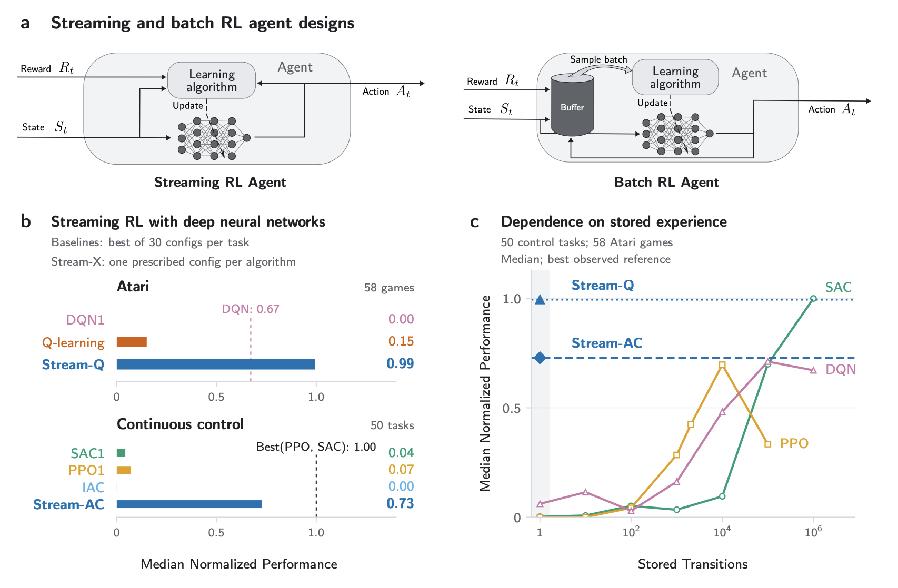

# Streaming Deep Reinforcement Learning

<p align="center">
  
</p>

This is the official **2026 implementation** of the <em>[Streaming Deep Reinforcement Learning Finally Works](https://arxiv.org/abs/2410.14606)</em> paper by [Mohamed Elsayed](http://mohmdelsayed.github.io), [Elena Sorina Lupu](https://lupusorina.github.io), [Gautham Vasan](https://gauthamvasan.github.io), and [A. Rupam Mahmood](https://armahmood.github.io).

Stream-X algorithms learn directly from their stream of experience. Here we include implementation of Stream-AC, Stream-RAC, Stream-Q, and Stream-SARSA.

For the official implementaiton of our 2024 version of the paper, you can go to the 2024 branch.

## Overview:
Learning from a stream of experience as it arrives, also known as streaming learning, is a core part of natural learning. However, reliable streaming learning has remained a persistent challenge in modern deep reinforcement learning (RL). Instead, most deep RL algorithms learn from old experience by storing past interactions in a buffer—an approach that can be restrictive in resource-constrained and privacy-sensitive applications. We show that both classical streaming RL, such as Q-learning and actor-critic, when used with deep neural networks, and batch deep RL, such as PPO, SAC, and DQN, when adapted to the streaming setting, often fail to learn. Across 58 Atari games and 50 continuous-control tasks, we find that these methods, in aggregate, perform close to random policies despite extensive task-specific hyperparameter searches. We call this pattern stream barrier. Here, we introduce Stream-X, a shared recipe for streaming deep RL algorithms that combines signal normalization, representation stabilization, and controlled parameter updates. By applying Stream-X to several base streaming RL algorithms, we provide the first family of deep RL algorithms to overcome the stream barrier. Using one prescribed hyperparameter configuration per algorithm across tasks, Stream-X substantially improves aggregate performance, often on par with batch RL algorithms.

<br/>

## Installation:
```
conda create -n drl python=3.11
conda activate drl
pip install -r requirements.txt
```

## How to use?
You can use [Classical Control](https://gymnasium.farama.org/environments/classic_control/) environments, [MuJoCo](https://gymnasium.farama.org/environments/mujoco/) environments, [Atari](https://gymnasium.farama.org/environments/atari/) environments, or [dm_control](https://github.com/google-deepmind/dm_control/) environments.


First, you need to activate the python environment
```
conda activate drl
```

Now, you can run any of the following cmds:
```
python stream_ac_continuous.py --debug --env Ant-v4
python stream_rac_continuous.py --debug --env Ant-v4

python stream_ac_discrete.py --debug --env CartPole-v1
python stream_ac_discrete_atari.py --debug --env BreakoutNoFrameskip-v4
python stream_ac_discrete_minatar.py --debug --env MinAtar/Breakout-v1

python stream_q.py --debug --env CartPole-v1
python stream_q_atari.py --debug --env BreakoutNoFrameskip-v4
python stream_q_minatar.py --debug --env MinAtar/Breakout-v1

python stream_sarsa.py --debug --env CartPole-v1
python stream_sarsa_atari.py --debug --env BreakoutNoFrameskip-v4
python stream_sarsa_minatar.py --debug --env MinAtar/Breakout-v1
```
After one of these scripts is done, you can use `plot.py` to plot the learning curve.

## Implementation of the 2024 version of the paper

The implementation of the 2024 version of the paper is preserved on the
[2024 branch](https://github.com/mohmdelsayed/streaming-drl/tree/2024).

## License

Distributed under the Creative Commons Attribution-NonCommercial 4.0 (CC BY-NC 4.0). License. See `LICENSE` for more information.


## How to cite

#### Bibtex:
```bibtex
@article{elsayed2026streaming,
  title={Streaming Deep Reinforcement Learning Finally Works},
  author={Elsayed, Mohamed and Lupu, Elena Sorina and Vasan, Gautham and Mahmood, A Rupam},
  journal={arXiv preprint arXiv:2410.14606},
  year={2026}
}
```

When reporting experiments with this implementation, also record the `2026`
branch's exact commit and your environment and command-line configuration.
